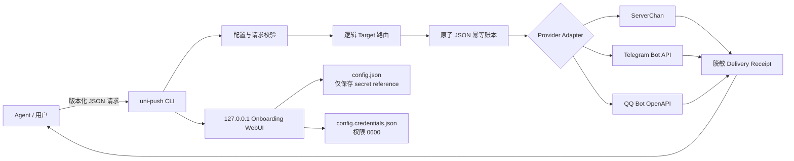
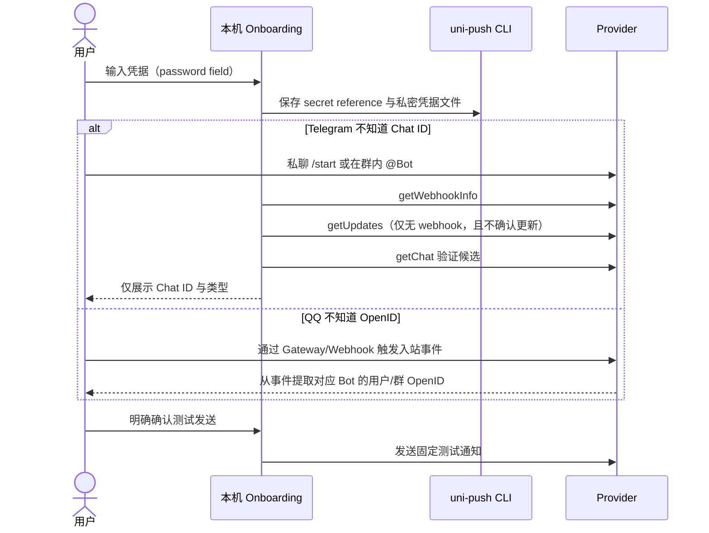
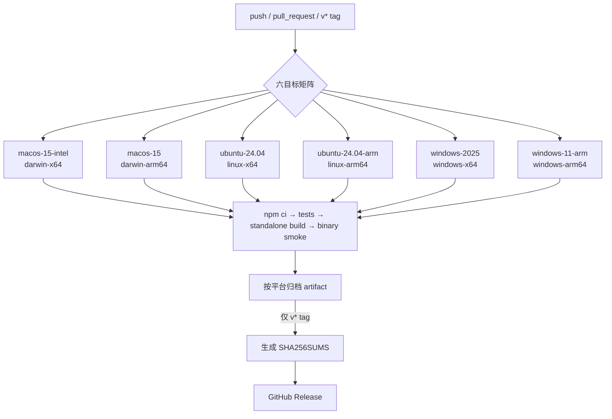

# Uni Push CLI

[中文](#中文) · [English](#english)

## 中文

Uni Push CLI 是面向 Agent 的统一外部通知命令行。它把配置、凭据解析、
目标路由、幂等投递、平台协议和本机 Onboarding 封装进一个独立二进制；
Agent Skill 位于本仓库 [skills/uni-agent-push](skills/uni-agent-push)，
只负责说明与安装、更新、诊断脚本。

首版支持：

- ServerChan（SCT、SC3）
- Telegram Bot
- QQ Bot（用户/群聊 OpenID）
- macOS、Windows、Linux 的 `x64` 与 `arm64`

### 架构



关键边界：

- 配置只保存 `store:<id>` 或 `env:VARIABLE`，不保存明文凭据。
- 保存凭据时使用跨进程文件锁覆盖完整的读改写过程，并发写入不同凭据不会互相覆盖。锁等待超过 5 秒返回 `credential_write_failed`；如果写入进程异常退出留下 `*.credentials.json.lock`，须先停止所有使用该配置的进程，再移除对应锁文件。
- `doctor` 不发送消息；Telegram 调用 `getMe/getChat`，QQ 只换取 Access Token。
- 同一 `notification_id` 与相同内容精确重放；内容变化则返回冲突。
- `uncertain` 不自动重试，避免重复通知。
- `accepted` 只代表平台 API 接受，不代表用户已经阅读。

### 安装与发布产物

正式二进制由 GitHub Actions 在对应原生架构 runner 上构建。Release 包含：

```text
uni-push-darwin-x64.tar.gz
uni-push-darwin-arm64.tar.gz
uni-push-windows-x64.zip
uni-push-windows-arm64.zip
uni-push-linux-x64.tar.gz
uni-push-linux-arm64.tar.gz
SHA256SUMS
```

推荐使用本仓库内置的 [Uni Push Skill](skills/uni-agent-push)
自动识别平台、校验 SHA-256 并安装。也可以从本仓库 Releases 手动下载。

### 使用

```bash
uni-push --version
uni-push onboard
uni-push targets --config ~/.config/uni-push/config.json --json
uni-push doctor --config ~/.config/uni-push/config.json --json
uni-push send --config ~/.config/uni-push/config.json --request request.json --dry-run --json
uni-push send --config ~/.config/uni-push/config.json --request request.json --json
```

发送请求示例：

```json
{
  "schema_version": 1,
  "notification_id": "build-20260812-001",
  "destination": { "kind": "target", "name": "telegram" },
  "message": {
    "title": "构建状态",
    "body": "构建已经完成",
    "format": "plain",
    "priority": "normal"
  },
  "policy": { "mode": "single" }
}
```

### Onboarding 与目标发现



### 构建与发布 Workflow



Node SEA 将应用 bundle 与 Onboarding 静态资源嵌入单文件；由于 Node SEA 明确不支持
macOS Intel，该目标使用 Bun standalone compile。目标机器均不要求安装 Node.js。
当前 macOS 仅做 ad-hoc 签名，Windows 未做商业证书签名；正式代码签名
与 notarization 是后续发布加固项。

### 开发

```bash
npm ci
npm run check
```

发行构建由 `.github/workflows/release.yml` 完成。本机 `npm run build` 仅用于
兼容的 Node 官方发行环境调试，不作为正式发行来源。

## English

Uni Push CLI is a unified external-notification command line for Agents. It
owns configuration, secret resolution, logical routing, idempotency, provider
protocols, and loopback Onboarding in one standalone binary. The Agent Skill in
this same repository at [skills/uni-agent-push](skills/uni-agent-push) contains
only documentation and thin lifecycle scripts.

The first release supports ServerChan, Telegram Bot, and QQ Bot on macOS,
Windows, and Linux for both `x64` and `arm64`.

### Design guarantees

- Config stores only `store:<id>` or `env:VARIABLE` references.
- `doctor` never sends a message.
- Exact notification replays return the stored receipt; changed content with a
  reused ID conflicts.
- `uncertain` delivery is never retried automatically.
- `accepted` means provider API acceptance only.

The architecture, Onboarding sequence, and native build matrix are shown in the
Mermaid diagrams in the Chinese section above; labels intentionally preserve
the protocol-level details shared by both languages.

### Quick start

Install through the bundled [Uni Push Skill](skills/uni-agent-push),
or download the matching archive and verify it against `SHA256SUMS`.

```bash
uni-push --version
uni-push onboard
uni-push targets --config ~/.config/uni-push/config.json --json
uni-push doctor --config ~/.config/uni-push/config.json --json
uni-push send --config ~/.config/uni-push/config.json --request request.json --json
```

### Development and release

```bash
npm ci
npm run check
```

`.github/workflows/release.yml` builds and smoke-tests all six native targets.
Tags matching `v*` publish archives plus `SHA256SUMS`. End users do not need a
Node.js installation. Node SEA is used where supported; macOS Intel uses Bun's
standalone compiler because Node SEA excludes that target. macOS artifacts are
currently ad-hoc signed and Windows
artifacts are unsigned; production certificate signing and notarization remain
release-hardening work.
